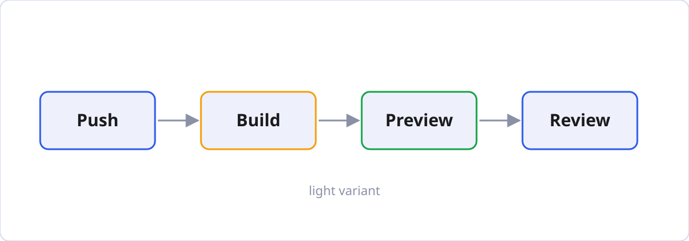

import CodeTabs from '@/components/CodeTabs.astro';
import ThemeImage from '@/components/ThemeImage.astro';
import diagram from '@/assets/blog/diagram.svg';
import diagramDark from '@/assets/blog/diagram-dark.svg';

This post shows each element the theme styles, with the Markdown that produces it. Switch between light and
dark mode with the button in the header to see both versions. On a wide screen, the "On this page" list on
the right highlights the section you're reading.

## Headings

Use `##` for sections and `###` or `####` below them. The page title is the post's `title`, so start at
`##`. Section headings appear in "On this page", and hovering over one shows a link icon for sharing that
section.

```md
## Second level

### Third level

#### Fourth level
```

### Third level

Third-level headings are indented in "On this page".

#### Fourth level

Fourth-level headings get a link icon but stay out of "On this page".

## Paragraphs and inline text

Text is set at a comfortable reading width. You can make text **bold**, *italic*, ***both***,
~~struck through~~ or `inline code`, and add [links](https://astro.build). Keyboard keys look like
<kbd>⌘</kbd> + <kbd>K</kbd>. Straight "quotes" and apostrophes become curly ones, and `--` becomes a dash.

```md
**bold**, *italic*, ***both***, ~~struck through~~, `inline code`, [links](https://astro.build)
<kbd>⌘</kbd> + <kbd>K</kbd>
```

## Lists

- Unordered lists use `-`
- Indent by two spaces to nest
  - like this
  - and this

1. Ordered lists use numbers
2. The numbers don't have to be in order
3. Markdown counts for you

- [x] Task lists use `- [x]`
- [ ] and `- [ ]` for unchecked items

```md
- Unordered item
  - Nested item

1. Ordered item

- [x] Done
- [ ] To do
```

## Blockquotes

> A blockquote is indented with a line in the accent colour. Use it for quotes from other people or
> sources.

```md
> A blockquote.
```

## Callouts

Callouts use GitHub's alert syntax, so the same Markdown also displays nicely on GitHub.

> [!NOTE]
> Useful information that readers should know, even when skimming.

> [!TIP]
> Helpful advice for doing things better or more easily.

> [!IMPORTANT]
> Key information readers need to succeed.

> [!WARNING]
> Urgent information that needs immediate attention to avoid problems.

> [!CAUTION]
> Advice about risks or negative outcomes of certain actions.

> [!TIP] Custom titles
> Text after the marker on the first line replaces the title.

```md
> [!NOTE]
> Useful information that readers should know, even when skimming.

> [!TIP] Custom titles
> Text after the marker on the first line replaces the title.
```

The five types are `NOTE`, `TIP`, `IMPORTANT`, `WARNING` and `CAUTION`. A blockquote without a marker stays
a normal quote. `NOTE` uses the accent colour. To change the others, set `--callout-tip`, `--callout-important`,
`--callout-warning` or `--callout-caution` in the [palette](../getting-started/#other-colours).

## Tables

| Element   | Markdown        | Notes                          |
| :-------- | :-------------: | -----------------------------: |
| Bold      | `**text**`      | Left-aligned column            |
| Italic    | `*text*`        | Centred column                 |
| Code      | `` `code` ``    | Right-aligned column           |

Wide tables scroll sideways on small screens instead of squeezing the text.

```md
| Element | Markdown   | Notes        |
| :------ | :--------: | -----------: |
| Bold    | `**text**` | Left-aligned |
```

## Code

Fenced code blocks are highlighted in colours that match light and dark mode. Every block has a **Copy**
button in its top-right corner (on hover, or always on touch screens).

```ts
export function greet(name: string): string {
  return `Hello, ${name}!`;
}
```

Add `title="…"` after the language to show a file name:

```ts title="src/lib/greet.ts"
export const greet = (name: string) => `Hello, ${name}!`;
```

Use the `diff` language to show changes:

```diff
- const accent = 'blue';
+ const accent = 'teal';
```

Long lines scroll sideways instead of wrapping:

```sh
npx astro build --verbose && npx pagefind --site dist --output-subdir pagefind --root-selector "main" --force-language en
```

````md
```ts title="src/lib/greet.ts"
export const greet = (name: string) => `Hello, ${name}!`;
```
````

## Code tabs

In `.mdx` posts, wrap code blocks in `CodeTabs` to show alternatives side by side. Each block's `title`
becomes its tab label.

<CodeTabs group="pkg">

```sh title="npm"
npm install astro
```

```sh title="pnpm"
pnpm add astro
```

```sh title="yarn"
yarn add astro
```

</CodeTabs>

Tabs with the same `group` switch together across the site, and the choice is remembered. This group also
switches the install commands in [Getting started](../getting-started/#install). Leave out `group` for tabs
that stand on their own:

<CodeTabs>

```yaml title="config.yaml"
title: Alex Doe
accent: teal
```

```json title="config.json"
{ "title": "Alex Doe", "accent": "teal" }
```

</CodeTabs>

````mdx
import CodeTabs from '@/components/CodeTabs.astro';

<CodeTabs group="pkg">

```sh title="npm"
npm install astro
```

```sh title="pnpm"
pnpm add astro
```

</CodeTabs>
````

Leave an empty line before and after each code block inside `CodeTabs`.

## Images

A Markdown image is optimised at build time:



```md

```

For an image with a dark-mode version, use `ThemeImage` in an `.mdx` post. Switch the theme to see this
diagram change. The optional `caption` adds a caption below the image:

<ThemeImage light={diagram} dark={diagramDark} alt="The preview pipeline" caption="The same diagram, drawn for light and dark mode." />

```mdx
import ThemeImage from '@/components/ThemeImage.astro';
import diagram from '@/assets/blog/diagram.svg';
import diagramDark from '@/assets/blog/diagram-dark.svg';

<ThemeImage light={diagram} dark={diagramDark} alt="The preview pipeline" caption="Optional caption" />
```

Unlike an HTML `picture` element, `ThemeImage` follows the site's theme toggle, not just the system setting.

## Footnotes

Add a footnote with a marker in the text[^1] and its text anywhere in the post. Footnotes are collected at
the bottom of the post with links back to where they're used.[^note]

```md
A marker in the text[^1].

[^1]: The footnote text.
```

## Horizontal rule

Three dashes on their own line draw a divider.

---

```md
---
```

[^1]: This is the first footnote.

[^note]: Footnote names can be words, but they're numbered in order on the page.
